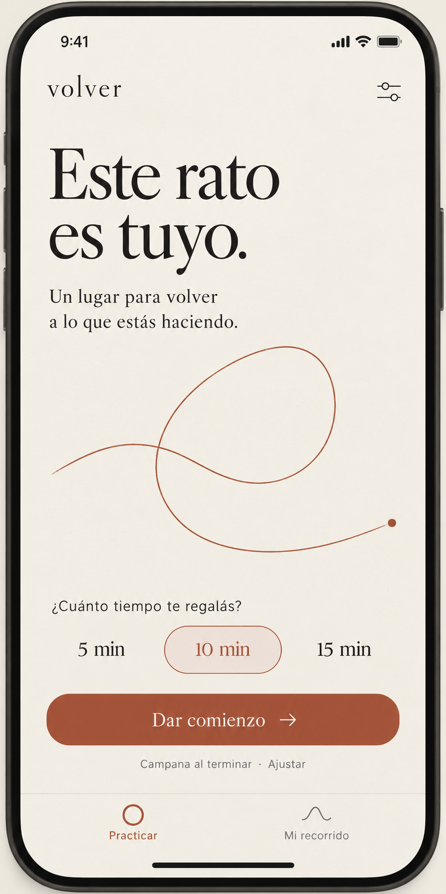

# Plan de refactorización integral de UI — Volver

Estado: implementación del rediseño terminada en este PR. Las comprobaciones automatizadas pasan; quedan pendientes las validaciones que exigen un dispositivo real y espacio libre para completar builds nativos.

## Resultado de implementación — 2 de noviembre de 2026

- Sistema visual Volver implementado con temas claro/oscuro/sistema persistidos, paleta como `ThemeExtension`, Newsreader + Source Sans 3 locales con licencias OFL y el hilo reutilizable de marca.
- Home reducido a Practicar / Mi recorrido, con presets conservados y selector de 1–120 minutos; Ajustes es una pantalla separada con sonido/preescucha, volumen, vibración, recordatorio, idioma, apariencia y privacidad. Se agregó `/settings`.
- Sesión y cierre migrados al tema; la pausa cancela la alarma nativa y la reanudación la programa con el tiempo restante. El estado pausado usa el mensaje «Podés volver cuando quieras»; se quitó el pulso infinito y el cierre ofrece «Silenciar campana».
- Historial conserva sus datos y permite borrar con confirmación; vacío y lectura de privacidad se integraron al sistema visual. Los recordatorios usan copy sin presión.
- Ícono y splash claro/oscuro generados para Android e iOS desde los recursos incluidos.
- `flutter analyze`: sin incidencias. `flutter test --concurrency=1`: 17 pruebas pasan, incluyendo tema y persistencia, guardado antes de salir de Ajustes y su error, presets y duración personalizada, layout estrecho con texto ampliado, hilo accesible, historial/borrado y canal Flutter de la alarma.
- `flutter build ios --debug --no-codesign`: completado; generó `build/ios/iphoneos/Runner.app`. Xcode también firmó, instaló y lanzó la app en un iPhone 12 conectado por Wi‑Fi.
- La sesión `flutter run` no pudo adjuntar el depurador: tras permitir Red local en iOS, Flutter agotó el tiempo esperando el servicio VM y reportó fallo mDNS. El proceso Runner fue visible en la lista de procesos de iOS, pero no se obtuvo captura ni se comprobaron interacciones en pantalla.
- El build Android debug sigue pendiente. El primer intento llenó el disco y corrompió el índice compartido de Gradle; el reintento falló por ese índice y dejó 116 MB libres. Se conservaron las cachés compartidas y se retiraron artefactos de compilación creados durante los intentos.
- Se agregó `.github/workflows/flutter.yml` para ejecutar análisis/tests y builds Android/iOS en runners limpios; falta que GitHub ejecute el workflow tras el siguiente push a esta rama.
- No se verificaron en dispositivo TalkBack/VoiceOver, audio, segundo plano, bloqueo ni arranque en frío. Estos puntos siguen marcados como validación manual pendiente; los tests Flutter no sustituyen esas pruebas.

## Objetivo y dirección

Convertir el temporizador de meditación en un espacio personal para practicar la atención. Principio de voz: «Distraerte es parte. Volver es la práctica». La experiencia debe permitir empezar con un toque, recordar preferencias y recibir sin culpa después de una ausencia.

La imagen `design/volver-home-reference.png` es la referencia de dirección artística. Es conceptual: no fija dimensiones, accesibilidad ni todos los estados. El nombre Volver se usa como identidad visual de trabajo; cambiar identificadores de paquete, fichas de tiendas y nombre público de distribución queda fuera de esta refactorización.

## Diagnóstico del código actual

- `lib/core/theme/app_colors.dart` centraliza una paleta oscura azul/violeta; varias pantallas además contienen colores y gradientes locales.
- `lib/core/theme/app_theme.dart` define solamente el tema oscuro y `lib/app.dart` lo usa como tema único.
- `home_page.dart` concentra configuración, recordatorios, idioma, historial y privacidad antes de iniciar. Su columna y los presets horizontales necesitan adaptación a pantallas pequeñas y texto ampliado.
- `meditation_page.dart` integra sesión activa/pausada, confirmación de cancelación y finalización; comparte el MeditationBloc del inicio.
- `alarm_fullscreen_page.dart` es una entrada independiente mediante `/alarm`, incluso al arrancar la app desde cero. Tiene animación pulsante, cambios de UI del sistema y coordinación de audio y notificación nativa.
- `history_page.dart` muestra sesiones locales y permite borrarlas con confirmación. El almacenamiento conserva hasta 200 entradas.
- `privacy_policy_page.dart` necesita el mismo lenguaje visual con prioridad para la lectura prolongada.
- Duración, sonido, botón principal y temporizador existen como widgets separados. Los textos EN/ES viven en `app_strings.dart`.
- Los cambios de preferencias del MeditationBloc actual se guardan al iniciar la sesión. Moverlos a Ajustes requiere definir guardado explícito y sincronización para que no se pierdan al salir.
- El TimerBloc pausa el contador Flutter; en el código revisado no coordina esa pausa con la alarma nativa ya programada. Se debe caracterizar este comportamiento antes de modificar sesión/pausa: el rediseño no debe prometer que la alarma se pausa sin comprobarlo.

## Sistema visual

### Tokens iniciales

| Rol | Claro | Oscuro |
| --- | --- | --- |
| Fondo | Papel `#F4F0E7` | Carbón cálido `#201D1A` |
| Texto principal | Tinta `#302D29` | Papel `#F4F0E7` |
| Texto secundario | `#686059` | `#C4B9AE` |
| Acción / hilo | Arcilla `#A7543D` | Arcilla clara `#D9987C` |
| Texto sobre acción | `#FFFFFF` | `#201D1A` |
| Superficie secundaria | `#EAE4DB` | `#302A25` |
| Separador | `#D4C9BC` | `#51473F` |

Son valores de partida: verificar contraste por combinación y estado antes de adoptarlos. Objetivos: 4.5:1 en texto normal, 3:1 en texto grande y elementos de interfaz relevantes. Nunca depender solo del color para comunicar selección/error.

- Dos familias tipográficas locales: serif humanista para mensajes y títulos; sans para controles y lectura extensa. Evaluar Newsreader + Source Sans 3, con licencia incluida y soporte de español. Validar legibilidad y tamaño de descarga antes de incorporarlas; sin carga remota de fuentes.
- Escala de espacio de 4/8/12/16/24/32/48. Márgenes habituales de 24; ancho de lectura limitado en tablet.
- Radios de 12–16 para botones/campos. Elevación mínima. Sin gradientes, halos ni sombra como señal principal de interacción.
- Ilustración de marca: un hilo asimétrico continuo que se desvía y vuelve. Implementarlo como recurso vectorial o CustomPainter reutilizable; no usar la imagen generada como UI ni crear una ilustración diferente por pantalla.
- El hilo será estático durante la sesión. Transiciones breves, respetando reducción de movimiento; retirar el pulso infinito de la alarma.
- `ThemeData`, `ColorScheme`, `TextTheme` y una `ThemeExtension` para tokens propios. Los componentes leen del tema; retirar constantes oscuras en la UI migrada.
- Iniciar siguiendo el tema del sistema y ofrecer Sistema/Claro/Oscuro en Ajustes, con persistencia separada de las preferencias de sesión.

## Navegación y pantallas

Navegación inferior simple: **Practicar / Mi recorrido**. Ajustes se abre desde el encabezado; Privacidad desde Ajustes. La sesión activa y la alarma son pantallas independientes sin navegación inferior.

| Pantalla / estado | Propuesta y acciones | Archivos principales |
| --- | --- | --- |
| Inicio listo | Marca pequeña, «Este rato es tuyo», hilo, duración, «Dar comienzo», resumen del sonido y acceso a Ajustes | `home_page.dart`, `duration_picker.dart`, `meditation_button.dart` |
| Duración personalizada | Presets 5/10/15 y «Otra duración»; selector accesible de 1 a 120 min; conservar cualquier valor previo, incluidos 20/30/60 | `duration_picker.dart`, nueva hoja de duración |
| Inicio cargando/error | Mantener estructura estable; desactivar inicio mientras se procesa; mensaje traducido con recuperación y sin detalles técnicos | `home_page.dart`, componentes de estado |
| Ajustes (nueva) | Sonido final y preescucha explícita, volumen, vibración según soporte real, recordatorio y hora, idioma, apariencia, privacidad | nueva `settings_page.dart`, `sound_selector.dart`, `app.dart` |
| Sesión activa | Tiempo legible, hilo discreto, instrucción breve, Pausar y Terminar; sin señales de rendimiento | `meditation_page.dart`, `timer_display.dart` |
| Sesión pausada | «Podés volver cuando quieras», tiempo detenido, Reanudar y Terminar; coordinar semántica con alarma real | mismos archivos |
| Cancelación | Confirmación con «Seguir practicando» y «Terminar ahora»; no registrar como completada una sesión cancelada | diálogo en `meditation_page.dart` |
| Final / alarma | «Gracias por hacerte este espacio», acción inequívoca «Silenciar campana»; detener audio y notificación antes de salir | `alarm_fullscreen_page.dart`, ruta `/alarm` |
| Mi recorrido con datos | Lista cronológica sobria, fecha y duración reales; pequeños trazos como identidad; sin puntuaciones de atención ni días vacíos como faltas | `history_page.dart` |
| Mi recorrido vacío | «Tu práctica empieza acá», explicación y acceso a Practicar | `history_page.dart` |
| Borrar historial | Acción secundaria con confirmación clara y resultado visible; mantener sesiones y ajustes independientes | `history_page.dart` |
| Privacidad | Encabezado sencillo, texto sans, jerarquía editorial, lectura y scroll accesibles | `privacy_policy_page.dart` |
| Superficies compartidas | Diálogos, snackbars, selectores, menús, foco, teclado, barras del sistema y permisos | tema y widgets comunes |
| Arranque y presencia nativa | Ícono basado en el hilo y splash claro/oscuro coherentes; revisar Android 12 e iOS | `pubspec.yaml`, recursos nativos generados |

Los permisos y alertas que pertenecen al sistema operativo conservan su UI nativa. La aplicación explicará su finalidad en el mismo tono.

## Reglas de experiencia y contenido

- Todos los textos nuevos deben tener EN y ES. El español usará voseo coherente; la versión inglesa se adaptará naturalmente.
- «Volver» será la identidad; el título editorial no reemplaza etiquetas funcionales como Pausar, Reanudar o Silenciar campana.
- Personalización inicial: recordar preferencias existentes. No sumar onboarding, cuenta, cuestionarios ni nombres obligatorios.
- Mostrar «Qué bueno volver» solo si una ausencia real puede deducirse del historial; si no, usar el mensaje neutro. No afirmar mejoras cognitivas basándose en minutos practicados.
- Revisar el copy de notificaciones de racha e inactividad para quitar presión, preservando horarios y comportamiento de programación. Si se decide cambiar la política de notificaciones, tratarlo como cambio funcional separado.
- No añadir narración, nuevos sonidos ambientales, ejercicios guiados ni monetización en este trabajo. Los sonidos disponibles siguen siendo señales de finalización.
- No agregar una segunda pantalla de cierre que compita con `/alarm`; resolver un único flujo de salida y evitar dobles registros de historial.

## Arquitectura y datos

1. Crear widgets comunes en `lib/core/widgets/`: scaffold de página, encabezado, botón primario/secundario, fila de ajustes, estado vacío y diálogo. Extraer solo patrones repetidos.
2. Mantener entidades, casos de uso, IDs de sonidos y claves existentes de SharedPreferences. Persistir solo la apariencia bajo una clave nueva.
3. Dar a Practicar y Ajustes una fuente de verdad compartida para preferencias. Elevar el alcance del bloc al flujo adecuado o crear un controlador específico de ajustes; documentar la elección al implementar. Evitar crear un segundo MeditationBloc independiente que desincronice la sesión.
4. Guardar cambios de Ajustes al confirmarlos, con feedback de error. Al volver a Practicar se reflejan inmediatamente; reiniciar la app conserva esos valores aun sin iniciar sesión.
5. Mantener `/`, `/history`, `/privacy`, `/alarm` y sus argumentos compatibles. Añadir `/settings`; compartir el shell de Practicar/recorrido sin reiniciar la sesión por cambiar pestañas.
6. No reescribir audio, alarmas, historial ni la infraestructura de notificaciones por motivos estéticos. Cualquier problema funcional detectado debe tener una corrección enfocada y validación propia antes de integrar la pantalla afectada.
7. Evitar nuevos paquetes de navegación/estado; reutilizar Navigator y flutter_bloc salvo necesidad comprobada.

## Secuencia de implementación

El trabajo se concentró en la rama `codex/volver-ui-plan` y el PR existente, según la indicación de completar allí el refactor. Las etapas siguientes se usaron como orden de implementación, no como PRs separados.

### Etapa 1 — Base visual y componentes (`codex/volver-ui-foundation`)

- Incorporar fuentes locales/licencias y recurso del hilo.
- Crear tokens claro/oscuro, temas de controles/diálogos y componentes compartidos.
- Implementar preferencia de apariencia y conexión en `app.dart`.
- Validar una pantalla representativa en ambos temas, contraste, texto ampliado y foco antes de migrar todas.
- Cierre: sin colores antiguos incrustados en componentes nuevos; funcionamiento offline completo.

### Etapa 2 — Practicar, Ajustes y navegación (`codex/volver-ui-home-settings`)

- Implementar el inicio fiel a la referencia con layout adaptable y presets + duración personalizada.
- Extraer ajustes de Home a su pantalla, conectar guardado y sincronización, incluyendo carga/error de persistencia.
- Crear shell de dos destinos y accesos a privacidad, idioma y apariencia.
- Cierre: empezar con preferencias guardadas requiere un toque; no se pierde ninguna opción existente ni un valor personalizado.

### Etapa 3 — Sesión y cierre (`codex/volver-ui-session`)

- Caracterizar primero pausa/reanudación y alarma nativa. Resolver cualquier divergencia reproducible con una corrección funcional enfocada antes de aprobar este flujo.
- Migrar temporizador, controles, estados de pausa, confirmación y alarma full-screen.
- Mantener una vía clara para silenciar; contemplar arranque en frío y retorno desde segundo plano.
- Cierre: tiempo, alarma, cancelación y registro de sesión tienen un resultado coherente y se completan una sola vez.

### Etapa 4 — Recorrido, privacidad y contenido (`codex/volver-ui-secondary`)

- Migrar lista, vacío, borrado y lectura de privacidad.
- Completar EN/ES, mensajes de carga/error, ayudas y copy de notificaciones.
- Cierre: todas las pantallas y superficies Flutter usan el sistema visual y los datos previos siguen disponibles.

### Etapa 5 — Ícono, splash y validación final (`codex/volver-ui-polish`)

- Adaptar el símbolo a ícono normal/adaptativo y splash; generar recursos mediante la configuración del proyecto.
- Revisar áreas seguras, barras del sistema, tablet, orientación, tamaños de texto y lectores de pantalla.
- Capturar todas las pantallas/estados en claro y oscuro y adjuntar evidencia al PR.
- Cierre: matriz de aceptación completada, revisión de cambios y builds de las plataformas soportadas; documentar límites del entorno.

## Validación prevista para la implementación

Este documento no requiere ejecutar builds de la aplicación. Las etapas de código deben incluir validación proporcional a sus cambios:

- `flutter analyze` y comprobación de formato en archivos modificados.
- Tests de widgets enfocados en navegación Practicar/Ajustes/Recorrido, presets + duración personalizada, estados de sesión, confirmaciones y errores de guardado. Preferir comportamiento a snapshots de detalles internos.
- Pruebas de persistencia que demuestren que datos existentes se leen y que nuevos ajustes sobreviven a reiniciar sin haber iniciado una sesión.
- Pruebas específicas de la coordinación pausa/alarma si se modifica su comportamiento; cubrir doble finalización.
- Revisión visual en 320/390 px y tablet, EN/ES, claro/oscuro, escala de texto 100%/200%, TalkBack/VoiceOver, objetivos táctiles mínimos de 48 dp, foco visible y reducción de movimiento.
- Pruebas en dispositivo para audio, bloqueo de pantalla, segundo plano y arranque en frío: un golden o un test de widget no demuestra que la alarma nativa funciona.
- Builds Android e iOS cuando el entorno lo permita. Registrar por plataforma los resultados y bloqueos reales; no extrapolar una plataforma a la otra.

### Matriz de aceptación de flujos

| Flujo | Resultado esperado |
| --- | --- |
| Primera apertura | Inicio utilizable, sin onboarding obligatorio ni permisos anticipados innecesarios |
| Usuario existente | Historial, sonido, duración, volumen, idioma y recordatorio conservados |
| Cambiar ajustes y cerrar | Valores persistidos al reabrir; errores de guardado visibles |
| Seleccionar 1, 10, 60 y 120 min | Valor íntegro y representación correcta, también para duraciones de una hora o más |
| Iniciar / pausar / reanudar | Contador y finalización respetan el tiempo efectivo definido y comprobado |
| Cancelar | No suena una alarma residual ni aparece una sesión completada |
| Finalizar en primer plano | Se puede silenciar, vuelve a Practicar y registra una sola sesión |
| Finalizar bloqueado o desde app cerrada | Ruta de alarma funciona sin depender del bloc de Home; audio/notificación se detienen |
| Historial vacío / existente / borrar | Lista correcta y confirmación de borrado sin afectar preferencias |
| Tema, idioma y texto grande | Todas las pantallas legibles sin controles recortados |
| Sin conexión | Tipografía, ilustraciones, ajustes, historial y práctica disponibles localmente |

## Riesgos y decisiones de ejecución

- **Pausa y alarma:** hay dos relojes actualmente separados. Es un riesgo funcional preexistente a reproducir, no un diagnóstico probado en dispositivo ni una razón para ocultar Pausar.
- **Duración de una hora o más:** `timer_display.dart` usa `inMinutes.remainder(60)`; definir formato `60:00` o `1:00:00` y validarlo para todo el rango.
- **Recreación de rutas/blocs:** al mover Ajustes, evitar que una nueva instancia borre preferencias pendientes o pierda callbacks de finalización.
- **Alarmas y cierre:** separar la composición visual de los efectos existentes; no usar una reconstrucción de widget para iniciar/detener audio varias veces.
- **Paridad iOS/Android:** el servicio nativo debe comprobarse en cada plataforma; conservar las configuraciones iOS existentes.
- **Privacidad:** conservar el texto legal durante la migración visual. Cualquier revisión de contenido legal/contacto requiere trabajo explícito aparte.
- **Nombre de marca:** usar Volver dentro de la propuesta; validar disponibilidad y decisión comercial antes de una publicación con cambio de nombre.

## Definición de terminado

- Todas las rutas, estados, selectores y diálogos del inventario usan el nuevo diseño.
- Inicio mantiene la simplicidad de la referencia y todos los ajustes siguen accesibles.
- El hilo, la tipografía y la voz forman una identidad consistente en claro y oscuro.
- Preferencias e historial existentes conservados; sin recursos que dependan de conexión.
- Accesibilidad y matriz funcional verificadas con evidencia, especialmente la alarma real.
- PRs revisados antes de integrarse y sin cambios de producto ajenos a esta UI.
